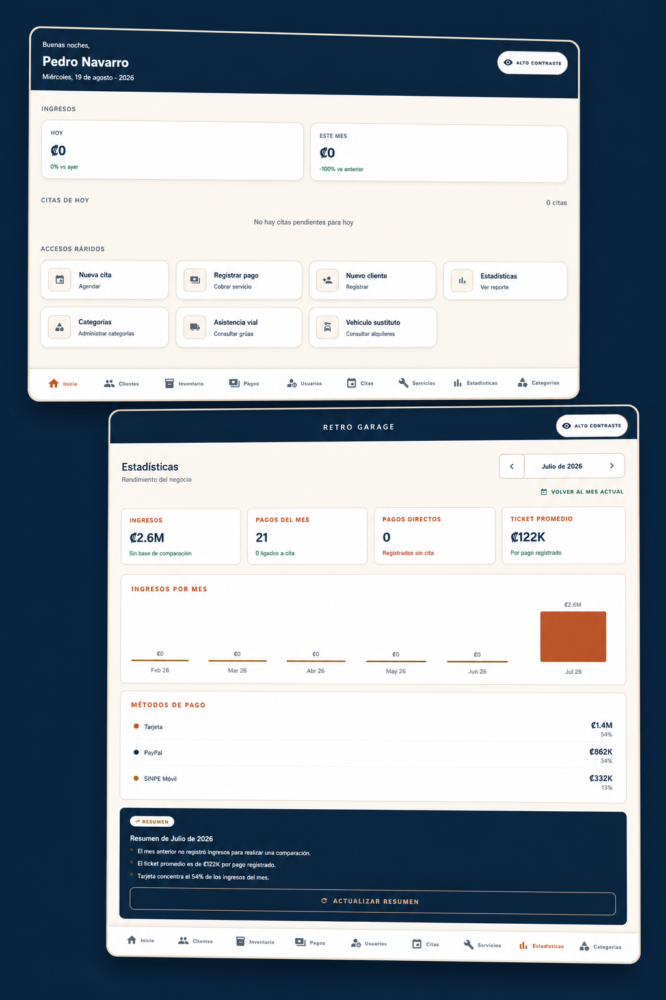
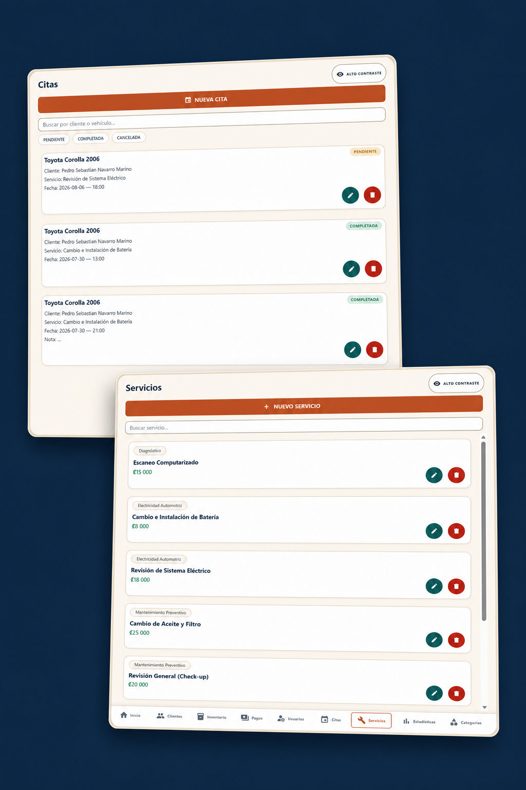
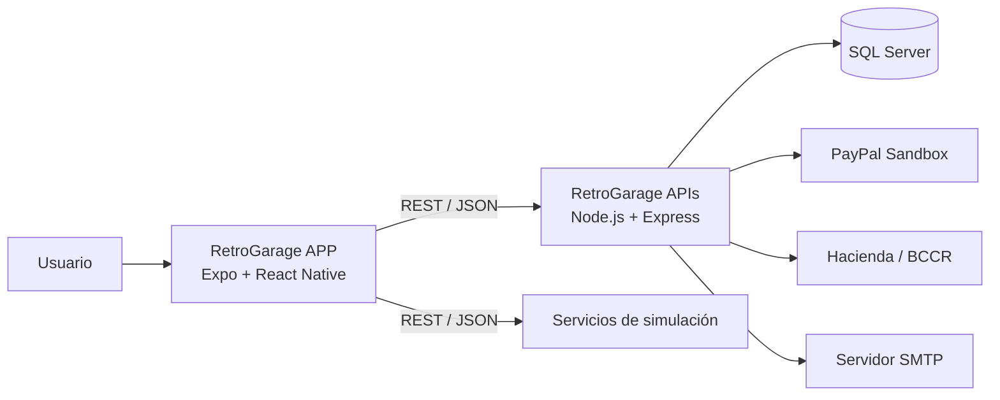

# RetroGarage APP

Aplicación web y móvil para administrar las operaciones de un taller mecánico desde una interfaz única. El proyecto fue desarrollado individualmente como trabajo universitario y consume una API REST en Node.js/Express, además de servicios simulados para consultas externas.

> **Estado:** prototipo académico funcional. No se publica una demo estable; la forma recomendada de evaluarlo es ejecutarlo localmente junto con sus servicios backend.

[](https://docs.expo.dev/versions/v56.0.0/)
[](https://reactnative.dev/)
[](https://www.typescriptlang.org/)

## Capturas

<p align="center">
  
  
</p>

## Funcionalidades principales

- Inicio de sesión con segundo factor y recuperación de contraseña por correo.
- Gestión de clientes, vehículos, usuarios, roles, servicios y categorías.
- Agenda de citas con estados y edición de datos del servicio.
- Inventario de productos, disponibilidad y control de existencias.
- Registro de pagos por tarjeta, SINPE Móvil y PayPal Sandbox.
- Consulta informativa del tipo de cambio para pagos locales.
- Dashboard operativo, estadísticas de ingresos y distribución por método de pago.
- Consultas simuladas de TSE, proveedores, aseguradoras, grúas y vehículos de alquiler.
- Tema de alto contraste y persistencia local de preferencias de accesibilidad.

## Tecnologías

- **Aplicación:** React Native, React 19, TypeScript y Expo SDK 56.
- **Navegación:** Expo Router con rutas basadas en archivos.
- **Estado y formularios:** Zustand, React Hook Form y Zod.
- **Comunicación:** Axios y Fetch sobre HTTP/JSON.
- **Persistencia local:** Expo SecureStore.
- **Estilos:** React Native StyleSheet y NativeWind/Tailwind CSS.

## Arquitectura



El frontend utiliza dos URLs configurables:

- `EXPO_PUBLIC_API_URL`: API principal; debe terminar en `/api`.
- `EXPO_PUBLIC_SIMULATIONS_API_URL`: servicio auxiliar de simulaciones, sin barra final.

## Requisitos

- Node.js y npm compatibles con Expo SDK 56.
- Expo Go, un emulador de Android/iOS o un navegador moderno.
- [RetroGarageAPIs](https://github.com/sebas1-1/RetroGarageAPIs) en ejecución.
- SQL Server y las integraciones opcionales configuradas desde el backend.

## Instalación local

```bash
git clone https://github.com/sebas1-1/RetroGarageAPP.git
cd RetroGarageAPP
npm ci
```

En PowerShell, crea el archivo local de configuración:

```powershell
Copy-Item .env.example .env.local
```

Para trabajar completamente en local, edita `.env.local`:

```env
EXPO_PUBLIC_API_URL=http://localhost:3001/api
EXPO_PUBLIC_SIMULATIONS_API_URL=http://localhost:8000
```

Inicia Expo:

```bash
npm start
```

Desde el menú de Expo puedes abrir la aplicación en web, Expo Go o un emulador. Si utilizas un teléfono físico, `localhost` apunta al propio teléfono: sustituye las URLs por la IP local de la computadora que ejecuta los servicios.

## Comandos disponibles

| Comando | Uso |
| --- | --- |
| `npm start` | Inicia el servidor de desarrollo de Expo. |
| `npm run android` | Abre el proyecto en Android. |
| `npm run ios` | Abre el proyecto en iOS. |
| `npm run web` | Abre la versión web. |
| `npm run lint` | Ejecuta las reglas de ESLint de Expo. |

## Estructura del proyecto

```text
src/
├── app/          # Pantallas y rutas de Expo Router
├── components/   # Componentes reutilizables y onboarding
├── config/       # URLs y configuración de servicios
├── contexts/     # Tema y accesibilidad
├── services/     # Clientes HTTP y persistencia local
├── store/        # Estado de autenticación
├── types/        # Tipos compartidos
└── utils/        # Validaciones y utilidades TOTP
```

## Seguridad y alcance

- Las variables `EXPO_PUBLIC_*` se incluyen en la aplicación compilada; nunca deben contener contraseñas, tokens privados ni secretos.
- Las preferencias, borradores y secretos locales compatibles se guardan mediante SecureStore.
- La versión académica todavía depende del identificador de usuario enviado al backend. Antes de manejar datos reales, el sistema requiere sesiones firmadas y autorización por usuario/rol en cada ruta.
- PayPal se utiliza en modo Sandbox. No introduzcas credenciales reales en el repositorio.

## Proyecto relacionado

- [RetroGarageAPIs](https://github.com/sebas1-1/RetroGarageAPIs): API REST, SQL Server, pagos, auditoría e integraciones externas.

## Autor

Desarrollado por [Pedro Sebastián Navarro](https://www.linkedin.com/in/pedro-sebastian-navarro) — [GitHub](https://github.com/sebas1-1).
